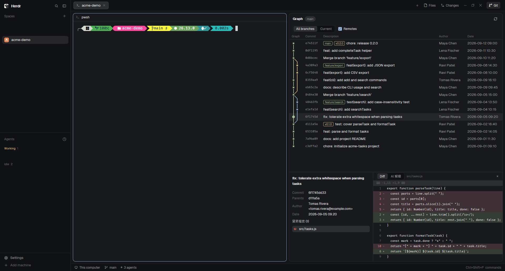

# herdr-git

A [Herdr](https://herdr.dev) layout with a Git panel on the right. It shows a commit graph with branch lanes, commit details, the changed files and a colored per-file diff. It can also ask Claude to explain the selected commit.



## Features

- **Commit graph.** The panel lists the latest 300 commits with colored branch lanes, merges, and branch and tag badges. You can show all branches or only the current one, and hide `origin/` badges.
- **Follows your focus.** The panel shows the repo of the focused pane, tab or space. It refreshes when `.git` changes, every 10 seconds, and when you press the refresh button.
- **Commit details.** Click a commit to see its hash, parents, author, date and changed files.
- **Colored diff.** Click a file to see its diff. Added lines have green backgrounds and removed lines have red backgrounds. A renamed file shows only the lines that changed.
- **AI 解釋 (AI explain).** One button runs Claude on the commit and shows the explanation as Markdown. It has a Cancel button and a 3-minute timeout. Each result is saved, so the same commit shows instantly next time. The prompt and this tab's text are in Traditional Chinese.
- **Git button.** A button at the right end of the tab bar shows or hides the panel.

## Requirements

- Herdr desktop app
- `git` on PATH
- For AI explain only:
  - [Claude Code](https://claude.com/claude-code) (`claude`) on PATH
  - on Windows, also `pwsh`

## Install

1. Copy `layouts/herdr-git.json` and `layouts/herdr-git.png` into `~/.config/herdr-app/layouts/`.
2. Copy `mods/git-graph/` into `~/.config/herdr-app/mods/`. If you already have a layout or mod with the same name, rename the new one and update the `mod` names inside the layout.
3. Check the mod and switch to the layout:

   ```sh
   herdr-app check ~/.config/herdr-app/mods/git-graph
   herdr-app do layout.switch '{"name":"herdr-git"}'
   ```

Press `ctrl-shift-l` to cycle back to your previous layout. To uninstall, delete the copied files.

You can also ask an agent in Herdr to add it from `https://github.com/weiyiao/herdr-git`. `RECIPE.md` is the full brief for rebuilding the layout from scratch.

## Before you install: what it runs

- **Programs.** The mod runs `git` with read-only commands. It uses `hc` (`run`, `wait`, `kill`, `ls`, `get`) to manage AI explain runs. It also runs `claude -p --model sonnet`, which may only use the Bash tools `git show`, `git diff` and `git log`.
- **Data sent to Anthropic.** AI explain sends the selected commit's content to Anthropic through your own Claude Code, and it uses your Claude quota. It runs only when you press 「用 Claude 解釋」, never on its own.
- **Saved files.** Explanations are saved in `~/.config/herdr-app/data/git-graph/explain/<hash>.md`.
- **Local only.** AI explain works only for repos on this machine. Graph, details and diff also work on remote machines.

## Limits

- The list shows at most 300 commits. The graph column shows at most 8 lanes, and extra lanes are cut off.
- A diff shows at most 1500 lines, and lines longer than 4000 characters are cut.
- In a worktree, `.git` is a file and can't be watched, so the panel updates every 10 seconds instead of at once.
- With Remotes unchecked, only `origin/` badges are hidden. Badges from other remotes still show.
- Place the `git-graph` panel in only one block. When the panel loads, it stops every running AI explain run that carries its label, including runs from other copies.
- The Git button toggles the node with the id `git-panel`. If you rename or remove that node, the button does nothing.

## Development

Run the tests from `mods/git-graph/`:

```sh
node graph.test.mjs
node explain.test.mjs
node parse.test.mjs
```

## License

[MIT](LICENSE)
