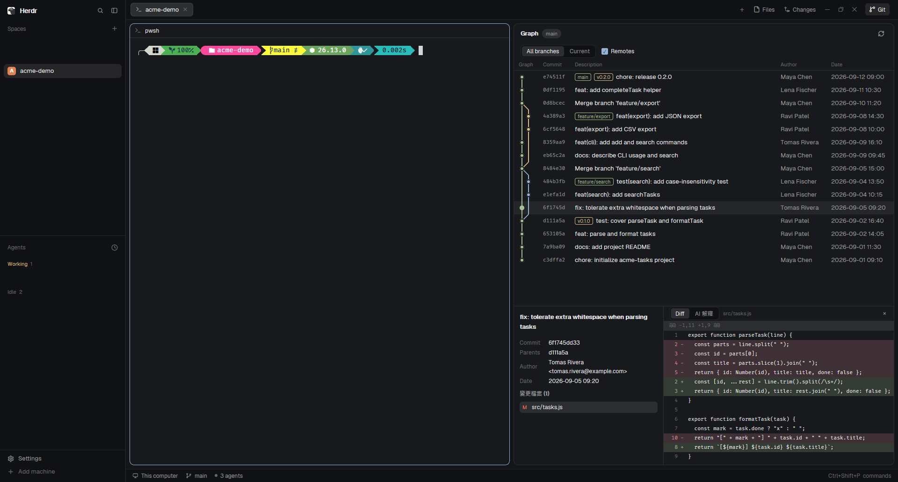

# herdr-git

A Herdr layout that puts a git commit graph on the right side of the window. On the left is the spaces and agents sidebar, in the middle is the active tab's terminal, and on the right is a Git panel. The panel lists the latest 300 commits with branch lanes. Click a commit and it expands below with details, the changed files and a per-file diff (red and green backgrounds). One button asks Claude to explain the commit; the prompt and the explanation UI text are in Traditional Chinese. A Git button at the right end of the tab bar shows or hides the panel.



## What you see

The whole window is one `row` with background `canvas`, a 1px `border` divider, `titlebar: "none"` (the layout draws its own title bar), `traffic_lights: [12, 16]` and `terminal_padding: [14, 12]`. Two columns:

**Left: `sidebar`, 268px wide, background `chrome`, not resizable by dragging** (`min` 44, `max` 480). Top to bottom:
- `brand`: 46px high, `workspace-chrome` mod, drags the window (`window_drag`).
- `sidebar-lists`: two blocks, `spaces` and `agents`, each `weight` 1 and `min` 90.
- `sidebar-footer`: 69px high, `workspace-chrome` mod, props `{"footer": true}`.

**Right: `work`, a `column` that is not resizable by dragging.** Top to bottom:
- `tabs-row`: a `row`, 42px high. The `tabs` mod takes the remaining width (`weight` 1, drags the window); on its right is `git-toggle`, 70px wide.
- `work-body`: a `row` with `padding` 8 and `gap` 8. Left to right:
  - `main`: the panes of the active tab (`tab: "active"`). Each pane is a card: background `background`, 1px `border`, 1px `accent` border when focused, `radius` 10, `gap` 8 between panes, `lone: true` (a single pane also gets the card), header is the `pane` mod, 30px high, at the top, `reveal: "always"`.
  - `panel`: 368px wide (`min` 280, `max` 900), `hidden: true` by default. It holds a `stack` (`panel-body`) with children `files` and `changes`, `active` is `files`. It is opened by the Files / Changes buttons in the tab bar.
  - `git-panel`: a `column` with `weight` 1 and `min` 560px, holding the `git-graph` block. Shown by default.
- `status`: 28px high, `workspace-status` mod.

**The Git panel** (the default role of the `git-graph` mod) is a card with radius 10px, background `background`, 1px `border`. Top to bottom:
1. Title row, 42px high: bold "Graph", a pill with the current branch (`selected` background, 11px, `muted` text; not shown when there is no repo), and on the right a 26px refresh button (`refresh.svg`, 14px, `muted`).
2. Filter row, 34px high: a segmented control "All branches" / "Current" (the chosen one has background `raised`, the other `chrome`; 22px high, 12px text), and next to it a "Remotes" checkbox (14px; when checked, background and border `accent` and the check mark `accent_foreground`).
3. Column header row, 24px high, 11px, `dim` text: Graph / Commit / Description / Author / Date.
4. Commit list: each row is 28px high (`ROW`), 10px padding left and right, 8px between columns. Column widths: Graph `max(44, lanes × 14 + 6)` px (`LANE` 14), Commit 60px (the configured `font_family`, JetBrains Mono when unset, 11px, `muted`, first 7 characters), Description flexible (ref badges first, then the subject on one line, truncated), Author 100px (`muted`, truncated), Date 124px (`muted`, `YYYY-MM-DD HH:mm`, `whitespace_nowrap`). The selected row has background `selected`; hover gives `hover`.
5. Detail area, 340px high (`DETAIL`), only present when a commit is selected, with a 1px `border` on its top edge and a 22px "×" close button at the top right:
   - Left column 320px wide, 1px `border` on its right edge, 12px padding: the commit message (bold, at most 48px high, scrolls when longer); Commit (first 10 characters), Parents (first 7 characters each, `none` when there are none), Author (`name <email>`), Date; the heading "變更檔案 (n)" (Chinese for "Changed files (n)"; 12px bold, `muted`); the file list, 24px per row, each starting with a status letter (A `ansi2`, D `ansi1`, M `blocked`, anything else such as R or C `ansi4`). The open file's row has background `selected`; hover gives `hover`.
   - Right column: a 32px toolbar with a segmented control "Diff" / "AI 解釋" ("AI explain") on the left and, on the Diff tab only, the current file path on the right (11px, `dim`); the content below.

**Branch graph.** Each commit is a dot 10px across with a 2px outline (`selected` when the row is selected, otherwise `background`). Lines are native stroked paths 2px wide. Lane colors cycle through `ansi2`, `ansi3`, `ansi4`, `ansi5`, `ansi6`, `ansi9`, `ansi10`, `ansi12`; at most 8 lanes are shown.

**Ref badges.** 16px high, 10px text, 1px border, radius 4px. Local branches and HEAD use `ansi2`, tags use `ansi3` (shown without the `tag: ` prefix), `origin/…` refs use `ansi5`.

**Diff area.** Font is the configured `font_family` (JetBrains Mono when unset), 11px, rows 20px high. On the left is a 30px wide right-aligned line number (the old number on a removed line, the new number on added and context lines), then a 10px wide `+` or `-`, then the content, with a 6px gap between them. Added and removed rows have background `ansi2` / `ansi1` plus alpha `33` (about 20%); their line number and sign use the same color. The `@@` header row has background `raised`, `dim` text and is truncated to one line.

**Git toggle** (`git-toggle`, the `toggle` role of the same mod): 26px high, 8px padding left and right, 5px between icon and text, radius 6px, 12px text. The icon is `git-branch.svg` (14px), the text is "Git". When the panel is shown: background `selected`, text `foreground`; when hidden: background `chrome`, text `muted`; hover gives `hover`. The whole strip has background `chrome`, a 1px `border` on its bottom edge and 10px padding on the right.

## How it behaves

**Data source and updates.** The panel follows focus: it takes the focused pane's cwd (else the focused terminal's cwd, else the active space's folder) and runs `git rev-parse --show-toplevel` there. When switching pane, tab or space changes that location, the panel clears, reloads and drops the selection. It updates on load, on the refresh button, on a filter change, every 10 seconds (`cx.timer.every(10000)`), and when the local repo's `.git` folder changes (`watchFolder`). A remote machine's space (its `machine`) relies on the 10 second timer only; the folder is not watched.

**Commit list.** Runs `git log --topo-order --format=%H%x1f%P%x1f%an%x1f%at%x1f%D%x1f%s%x1e -n 300 <scope>`, at most 300 commits (`MAX_COMMITS`). Scope: All branches with Remotes checked is `--all`; Current is `HEAD`; Remotes unchecked is `--branches --tags` and hides badges that start with `origin/`. An empty repo shows "No commits yet"; no folder shows "No folder"; while loading it shows "Loading…"; a non-repo shows "Not a git repository".

**Selecting.** Click a row to select it; click the same row again to deselect; the "×" at the top right also deselects. Selecting reads `git show -s` and `git diff-tree -r --root --no-commit-id --name-status -z -M` (merge commits and ordinary commits are both compared with the first parent; a root commit has no parent) and automatically opens the first file in the file list. Click a file name to switch the diff. If the selected commit is gone after a refresh, the selection is dropped.

**Diff.** Only the part from the first `@@` on is used; the file header is skipped. At most 1500 lines; a line longer than 4000 characters is cut and gets "… (line truncated)" appended. With no text difference (binary or empty) it shows "No text diff available (binary or empty)"; if the diff cannot be read (too large, or the read failed) it shows "Cannot preview this diff (too large or unreadable)". For a renamed (R) or copied (C) file the pathspec carries both the old and the new path with `-M`, so only the changed hunks show and the file does not appear as a whole-file add. The diff area scrolls vertically and horizontally (content width `max(300, longest line length × 7 + 50)` px).

**AI explain tab.** The prompt sent to Claude and every string on this tab are in Traditional Chinese (see Built from). By default nothing is run: the tab shows a Chinese note ("用 Claude 讀這個 commit 的內容並以正體中文解釋。會執行 claude，消耗你的 Claude 額度，結果存檔，下次直接顯示。", roughly "Read this commit with Claude and explain it in Traditional Chinese. This runs claude, uses your Claude quota, saves the result and shows it next time.") and a "用 Claude 解釋" ("Explain with Claude") button (`solid` background, `solid_foreground` text):
- On selecting a commit, if `~/.config/herdr-app/data/git-graph/explain/<hash>.md` exists it is shown at once (rendered as Markdown, scrollable) and nothing is run.
- Only pressing the button starts a run. While running the tab shows a spinner (`spinner.svg` from `workspace-chrome`, one turn per 900 ms), "Claude 正在讀這個 commit…" ("Claude is reading this commit…") and a "取消" ("Cancel") button.
- Pressing Cancel ends that terminal, shows the error "已取消" ("Cancelled") and deletes the unfinished files.
- After 180000 ms (`EXPLAIN_TIMEOUT_MS`, 3 minutes) the run is ended automatically and the tab shows "逾時：Claude 超過 3 分鐘沒有完成，已自動結束" ("Timed out: Claude did not finish within 3 minutes and was ended automatically"). If the result file was already fully written at that moment, the result is shown instead of the timeout.
- On failure the tab shows `exit code <n>` and claude's stderr (when there is no output at all: "Claude 沒有產生結果，也沒有錯誤訊息", "Claude produced no result and no error message"), in `ansi1`, with a "重試" ("Retry") button. Cancel and timeout also end in an error with the Retry button.
- For a repo on a remote machine the tab shows "AI 解釋目前只支援本機 repo" ("AI explain currently supports local repos only") and no button.
- Every commit is independent: if you switch to another commit while a run is going, the first run keeps going and its state is still there when you come back.
- When the panel is closed, it kills the runs it started.

**States.** This mod has no look of its own for agent states (working / blocked / done / idle); the `agents` and `spaces` lists on the left and the pane headers use Herdr's built-in styling.

## Built from

**Layout node tree** (`layouts/herdr-git.json`, these are the `id`s):
```
root (row)
├─ sidebar (column, 268px) ── brand (46px, workspace-chrome) / sidebar-lists (column: spaces, agents) / sidebar-footer (69px, workspace-chrome {footer:true})
└─ work (column)
   ├─ tabs-row (row, 42px) ── tabs (weight 1, tabs) / git-toggle (70px, git-graph {role:"toggle"})
   ├─ work-body (row, padding 8, gap 8)
   │  ├─ main (tab: active, pane cards, header: pane)
   │  ├─ panel (column, 368px, hidden) ── panel-body (stack, active: files) ── files (files) / changes (changes)
   │  └─ git-panel (column, weight 1, min 560) ── git-graph (git-graph)
   └─ status (28px, workspace-status)
```
The root also sets `"preview": "layouts/herdr-git.png"` (the picture the settings screen shows). `git-toggle` and `git-graph` use the same mod and differ by `props.role` (`toggle`; without it, the panel).

**Herdr's built-in mods used:** `workspace-chrome`, `spaces`, `agents`, `tabs`, `pane`, `files`, `changes`, `workspace-status`; and `workspace-chrome/spinner.svg`.

**`mods/git-graph/`** (`mod.json`: `{ "place": "none", "title": "Git" }`):
- `main.js`: the UI, data loading and the AI explain flow. It takes `View`, `div`, `svg`, `PathBuilder` from `gpui-kit` and `v_flex`, `h_flex`, `Scrollbar`, `v_virtual_list`, `TextView` from `gpui-base`; from `herdr` it uses `spaces`, `panes`, `focused`, `exec`, `watchFolder`, `readTextFile`, `appHome`, `window`, `theme`, `settings`, `layout`, `run`, `props`; it also uses `fs/promises` to write the AI explain helper files.
- `graph.js`: `layoutGraph(commits)` computes each row's lane, color and line segments from the order of `git log --topo-order`.
- `parse.js`: `parseFiles` (parses `diff-tree -z --name-status`) and `diffArgs` (the git arguments for a single file's diff).
- `explain.js`: `explainOutcome` (decides what the AI panel shows) and `reapRuns` (ends leftover runs and removes their temporary files).
- `*.test.mjs`: tests for the three pure modules above.
- `git-branch.svg`, `refresh.svg`: lucide icons, drawn with `svg("mods/git-graph/…")` in the text color.

**Herdr command called:** `layout.toggle {id: "git-panel"}` (the Git button).

**External programs run (`exec`):**
- `git`: `rev-parse --show-toplevel`; `log`, `branch --show-current`, `show -s`, `diff-tree`, `diff`, `show --format=`. Everything except `rev-parse` gets `--no-optional-locks -c core.fsmonitor=false -c diff.autoRefreshIndex=false`, so reading never writes to `.git` (otherwise the folder watch would trigger the next refresh). Diffs also get `--no-ext-diff --no-textconv --no-color`.
- `hc`: `run`, `wait`, `kill`, `ls`, `get`.
- `claude`: only after "用 Claude 解釋" is pressed, started through `hc run --json --bg --no-parent --label git-graph.explain=1 --label git-graph.hash=<hash> --cwd <repo root> -- <runner>`. The runner is `pwsh -NoProfile -NonInteractive -File <hash>.ps1` on Windows and `sh <hash>.sh` elsewhere. The script runs `claude -p --model sonnet --strict-mcp-config --allowedTools "Bash(git show:*)" "Bash(git diff:*)" "Bash(git log:*)"`, reads the prompt from `<hash>.prompt.txt` on stdin, writes the output to `<hash>.md.tmp` first and renames it to `<hash>.md` only on success (exit code 0 and a non-empty file); on failure it writes `<hash>.err`. The prompt is Traditional Chinese: it asks for an explanation in Traditional Chinese, to run `git show --stat <hash>` and then `git show <hash>` (for a merge commit, `git diff <first parent> <hash>` instead), to read only and change no file, and to answer in Markdown with three sections: `## 摘要` (summary), `## 主要變更` (main changes), `## 值得注意` (things to note: risks, possible bugs, missing tests; "無" if none).
- Waiting: a loop of `hc wait <address> --timeout <1–20 seconds> --json`, each call under `exec`'s 30 second limit.

**Files:** reads and writes `~/.config/herdr-app/data/git-graph/explain/` (`<hash>.prompt.txt`, `.ps1` / `.sh`, `.md`, `.err`, `.md.tmp`, `.log.tmp`); everything else it reads is the repo itself. There are no network requests (`fetch`).

**Cleanup on load:** when the panel starts it runs `hc ls --json --label git-graph.explain=1`, runs `hc kill` on every terminal that is still alive, then reads the `git-graph.hash` label with `hc get <address> --json` and deletes that commit's `.md.tmp` and `.log.tmp`.

## Watch out

**This mod runs external programs.** Through `exec` it runs `git` (read-only arguments), `hc` (`run` / `wait` / `kill` / `ls` / `get`) and `claude -p --model sonnet --strict-mcp-config` (allowing only the `git show`, `git diff` and `git log` Bash tools). Read `main.js` before installing.

**AI explain sends data to Anthropic.** The selected commit's diff goes through your own Claude Code to Anthropic and uses your Claude quota. It only runs when "用 Claude 解釋" is pressed, never automatically. The result is saved as `~/.config/herdr-app/data/git-graph/explain/<hash>.md` and read from there next time.

**The AI explain text is Chinese.** The prompt, the answer language, the tab name "AI 解釋", the button and status strings (用 Claude 解釋, 取消, 重試, 已取消, 逾時…, Claude 正在讀這個 commit…, Claude 沒有產生結果，也沒有錯誤訊息, AI 解釋目前只支援本機 repo) and the "變更檔案 (n)" heading are hard-coded in `main.js` / `explain.js`. A build for another language has to change those strings and the prompt.

**Runtime.** On Windows `claude` and `pwsh` must be on PATH. The POSIX `sh` runner is written but untested.

**AI explain supports local repos only.** A space on a remote machine shows "AI 解釋目前只支援本機 repo". Supporting it would mean `hc run --on` and reading the result with `readTextFile`'s `on`.

**The `git-graph.explain=1` label cleanup.** When the panel loads it ends every still-running terminal that carries this label, including ones started by another git-graph copy. So the mod may only be placed in one panel block (this layout has exactly one, plus the toggle role, which runs nothing); with several panel blocks, one loading would kill another's running explanation.

**The Git button depends on a node id.** The toggle runs `layout.toggle {id: "git-panel"}`; the layout must contain a node with `id` `git-panel`, and renaming or removing it makes the button do nothing.

**Keep the Date cell on one line.** At 112px `YYYY-MM-DD HH:mm` wraps onto two lines and overlaps the next row; 124px with `whitespace_nowrap` fits the default UI font.

**Built-in `changes` diff tint is faint.** `panel-body` points at Herdr's built-in `changes`, whose added/removed backgrounds are lighter. It is not part of this repo and is not modified.

**Limits left in `main.js` (`shortcut:`):**
- A worktree's `.git` is a file and cannot be watched, so it only updates on the 10 second timer (about 10 seconds of lag).
- With Remotes unchecked only badges starting with `origin/` are hidden; badges of other remote names still show, so multi-remote repos are not handled fully.
- The graph column shows at most 8 lanes; extra lanes are clipped and there is no horizontal scrolling.
- AI explain supports local repos only.
- The label cleanup ends every labeled run, including those of another git-graph copy.

**Other numeric limits:** at most 300 commits in the list; diffs at most 1500 lines and 4000 characters per line; AI explain times out after 180000 ms.

**Layout assumptions.** The layout sets no `theme` and no `font`; it uses your settings.json. All colors are theme color names with no hard-coded hex values (the `ansi2` / `ansi1` backgrounds are the theme color plus alpha `33`). `panel` is hidden by default and opened by the built-in tab bar's Files / Changes buttons; this repo's layout offers no other way to open it.

## Done when

- `node graph.test.mjs`, `node explain.test.mjs` and `node parse.test.mjs` (run inside `mods/git-graph/`) all pass.
- `herdr-app check <the mods/git-graph folder>` passes.
- After putting `layouts/herdr-git.json` into `~/.config/herdr-app/layouts/` and `mods/git-graph/` into `mods/`, running `herdr-app do layout.switch --name herdr-git` leaves no `layouts/layout.error`, and `herdr-app status` shows `errors: []`.
- The tab bar has a "Git" button at its right end; clicking it hides or shows the Git panel on the right, and while the panel is shown the button background is `selected`.
- In a tab inside a git repo, the panel shows the branch pill, the commit list and colored branch lines, and the ref badge colors match the above (local `ansi2`, tag `ansi3`, `origin/` `ansi5`).
- Clicking a commit expands a 340px high detail area showing Commit, Parents, Author, Date and the file list and opening the first file automatically; added diff lines have a green background, removed lines a red background, and their line numbers and `+` / `-` use the same color.
- Selecting a commit that contains a rename and clicking that file shows only the changed hunks, not a whole-file add.
- Unchecking Remotes makes the `origin/` badges disappear; switching to Current leaves only HEAD's history in the list.
- Pressing "用 Claude 解釋" shows the spinner and "取消"; pressing Cancel shows "已取消" and leaves no `<hash>.md.tmp` under `explain/`; waiting more than 3 minutes shows "逾時：Claude 超過 3 分鐘沒有完成，已自動結束". A successful explanation is saved as `<hash>.md` and shown at once when you leave the commit and come back.
